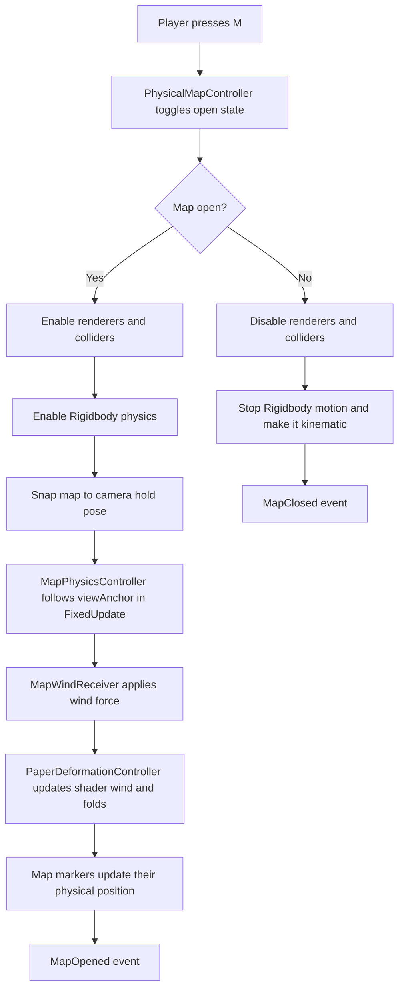

# Physical Map System

## Purpose

This system creates a real 3D map object for first-person use. It is not a HUD and does not require hands, IK, Animator, inventory, compass, or save data. It supports both Unity's legacy input and the Input System when either one is enabled, and can display approximate physical markers for the player and narrative objectives.

## Fast Integration

1. Open the gameplay scene.
2. Run `StoryTell > Physical Map > Install In Active Scene`.
3. Move `PhysicalMap_WorldOrigin` to the center of the playable area.
4. Set the represented world size on `MapWorldReference`.
5. Assign the final map image to `PaperMapMaterial > Map Texture`.
6. Select any objective Transform and run `StoryTell > Physical Map > Add Selected As Objective Marker`.
7. Press Play and use `M`.

The installer can be run again safely. It updates the reusable prefab, assigns the current `MainCamera`, creates a default world origin when needed, and includes a replaceable cyan player marker.

## Design

- `PhysicalMapController` owns the open/close state and reads the configured `KeyCode`.
- `PhysicalMapController` automatically finds a late-created `MainCamera`, exposes `Configure`, and applies a short scale transition without requiring an Animator.
- `MapSettings` is the designer-facing ScriptableObject for input, mesh density, hold pose, paper deformation, wind, and bend points.
- `MapPhysicsController` keeps the Rigidbody physical while pulling it toward a camera-relative hold pose.
- `MapWindReceiver` applies simple physical wind with `Rigidbody.AddForce` and forwards wind values to the shader.
- `PaperDeformationController` builds a subdivided mesh and sends deformation values to the material with a `MaterialPropertyBlock`.
- `PaperDeformation.shader` handles visual-only paper bend, waves, wind motion, and local fold zones.
- `PhysicalMapController` exposes `MapOpened` and `MapClosed` events for future integrations.
- `MapWorldReference` converts positions from a configured world area to the physical paper surface.
- `MapMarkerController` places a physical marker over the map and can follow the player, an objective, or a fixed position.
- `PhysicalMapPrefabCreator` provides one-click scene installation and objective-marker creation.

## Runtime Pipeline



## Recent Logic Changes

- `PhysicalMapController` now emits `MapOpened` and `MapClosed`.
- `PhysicalMapController` passes `MapSettings` to `MapWindReceiver`, so wind settings stay centralized.
- Selected map objects now draw gizmos for the camera hold pose and physical map bounds.
- `MapPhysicsController` ignores wind forces while the Rigidbody is inactive or kinematic.
- `PaperDeformationController` now lazily creates its `MaterialPropertyBlock` when settings are applied from editor-time validation.
- The prefab creator warns if Unity has not imported the paper shader yet.
- The prefab creator assigns `Camera.main` as `viewAnchor` when one exists in the open scene.
- `MapWorldReference` maps a rotated world rectangle to the local XZ surface of the paper.
- `MapMarkerController` supports tracked and fixed positions, optional clamping, and hiding outside the represented area.

## What Should Happen

When the system is working:

1. The map starts hidden.
2. Pressing `M` shows a real 3D map object in front of the camera.
3. A short open/close scale transition avoids an abrupt HUD-like appearance.
4. The object has `MeshRenderer`, `MeshFilter`, `Rigidbody`, and `BoxCollider`.
5. The map follows the camera using physics, not UI anchoring.
6. Gravity and wind still influence the object slightly.
7. The shader gives the paper visual curve, waves, wind movement, fold zones, and double-sided rendering.
8. Configured player and objective markers appear over the paper.
9. Pressing `M` again hides the map and stops its physical motion.

## Folder Structure

```text
Assets/Systems/PhysicalMapSystem/
  Data/
    SO_MapSettings_Default.asset
  Prefabs/
    PhysicalMap.prefab
  Materials/
    PaperMapMaterial.mat
  Shaders/
    PaperDeformation.shader
  Scripts/
    Core/
      PhysicalMapController.cs
      MapSettings.cs
      MapBendPoint.cs
    Physics/
      MapPhysicsController.cs
      MapWindReceiver.cs
    Visual/
      PaperDeformationController.cs
    Navigation/
      MapWorldReference.cs
      MapMarkerController.cs
  Editor/
    PhysicalMapPrefabCreator.cs
  Documentation/
    README.md
```

## Create the Prefab

1. Let Unity compile the scripts.
2. Open `StoryTell > Physical Map > Create Default Assets`.
3. Unity creates:
   - `Data/SO_MapSettings_Default.asset`
   - `Data/PhysicalMap_50x50_GeneratedMesh.asset`
   - `Materials/PaperMapMaterial.mat`
   - `Prefabs/PhysicalMap.prefab`

## Manual Setup Pipeline

Use this order the first time you install the system:

1. Open the Unity project.
2. Wait until Unity finishes compiling.
3. Run `StoryTell > Physical Map > Create Default Assets`.
4. Open the scene where the player exists.
5. Drag `Assets/Systems/PhysicalMapSystem/Prefabs/PhysicalMap.prefab` into the scene.
6. Select the `PhysicalMap` object.
7. Assign the player camera to `PhysicalMapController > View Anchor`.
8. Assign a real map texture to `PaperMapMaterial > Map Texture`.
9. Add `MapWorldReference` and assign a scene transform placed at the center of the represented area.
10. Create marker children with `MapMarkerController`.
11. Press Play.
12. Press `M` to open and close the map.

Use this manual pipeline only when you need a non-standard prefab. For normal scenes, prefer `Install In Active Scene`.

## Scene Setup

1. Drag `PhysicalMap.prefab` into a scene.
2. Assign the player camera to `PhysicalMapController.viewAnchor`. If empty, it falls back to `Camera.main`.
3. Add `MapWorldReference` to the map root.
4. Assign `worldOrigin` and the real width/depth represented by the texture.
5. Add a small physical marker as a child and attach `MapMarkerController`.
6. Enable `useMainCameraAsFallback` for the player marker, or assign an objective Transform.
7. Press Play and use `M` to show or hide the map.

## Test Pipeline

### Test 1: Asset Creation

Expected result:

- `SO_MapSettings_Default.asset` exists in `Data`.
- `PhysicalMap_50x50_GeneratedMesh.asset` exists in `Data`.
- `PaperMapMaterial.mat` exists in `Materials`.
- `PhysicalMap.prefab` exists in `Prefabs`.

If this fails, check that Unity finished compiling before running the menu item.

### Test 2: Toggle Input

Expected result:

- At Play start, the map is hidden.
- Press `M` once and the map appears.
- Press `M` again and the map disappears.
- Optional listeners receive `MapOpened` and `MapClosed`.
- No Unity Input System setup is required.

If this fails, check `SO_MapSettings_Default.mapKey`.

### Test 3: Camera Hold Pose

Expected result:

- The map appears in front of the camera.
- Rotating the camera makes the map follow.
- The movement has slight physical smoothing.
- Selecting the map in the editor shows gizmos for the target hold pose.

If the map appears in the wrong place, tune:

- `localHoldPosition`
- `localHoldEulerAngles`
- `followStrength`
- `rotationStrength`

### Test 4: Physical Object

Expected result:

- The prefab has a non-kinematic `Rigidbody` while open.
- The prefab has a `BoxCollider`.
- The map reacts subtly to gravity and wind.

If the map falls away too much, increase `followStrength` or reduce `windStrength`.

### Test 5: Visual Deformation

Expected result:

- The map is not perfectly flat.
- `bendStrength` changes the broad curve.
- `foldAmount` changes local folds.
- `windStrength` changes both movement and shader waves.

If nothing deforms, confirm that `PaperMapMaterial` uses `StoryTell/PhysicalMap/PaperDeformation`.

### Test 6: Player and Objective Markers

Expected result:

- Opening the map shows each enabled marker.
- Moving the tracked target moves its marker over the paper.
- A target outside the represented area clamps to the edge by default.
- Enabling `hideWhenOutsideMap` hides an out-of-bounds marker.
- Closing the map hides all marker renderers.

If a marker appears mirrored, use `invertHorizontal` or `invertVertical` on `MapWorldReference`.

## Material Setup

Assign the real map image to `PaperMapMaterial` in the `_BaseMap` texture slot.

## Tuning

- Increase `subdivisionsX` and `subdivisionsY` for smoother deformation. The default is 50x50.
- `openCloseDuration` controls the lightweight open/close transition. Set it to zero for an instant toggle.
- `closedScale` controls how much the paper shrinks during that transition.
- Use `bendStrength` for broad paper curvature.
- Use `foldAmount` plus `bendPoints` for local folds.
- Use `windStrength` for both Rigidbody force and shader wave intensity.
- Use `followStrength` and `rotationStrength` to decide how tightly the physical map stays in front of the camera.

## Quick Troubleshooting

### The menu item does not appear

Wait for Unity to finish compiling. If there are compile errors elsewhere in the project, Unity will not load the editor tool.

### The map does not open

Check that the `PhysicalMap` object is active in the scene. The system hides renderers and colliders, not the root GameObject, so the controller must remain active.

### The map opens but is invisible

Check the `MeshRenderer`, material assignment, and camera clipping planes. Also confirm that `PaperMapMaterial` has a visible base color and texture.

### The map does not follow the player

Assign the player camera manually to `PhysicalMapController.viewAnchor`. The automatic fallback only works when the camera is tagged as `MainCamera`.

### The map shakes too much

Reduce `windStrength`, increase Rigidbody damping, or lower `followStrength` slightly if the camera movement is very abrupt.

### The map looks too rigid

Increase `bendStrength`, `foldAmount`, or `windStrength`. For smoother deformation, increase mesh subdivisions and regenerate the mesh/prefab.

## Minimal Functional Checklist

Before considering the system ready, confirm:

- The prefab is present in the scene.
- The root GameObject stays active.
- `PhysicalMapController` has a `MapSettings` asset assigned.
- `MapPhysicsController`, `MapWindReceiver`, and `PaperDeformationController` are on the same object.
- The material uses the paper deformation shader.
- The camera is assigned as `viewAnchor`.
- The map opens and closes with `M`.
- The map texture is readable in first person.
- `MapWorldReference` has a world origin and dimensions matching the scene.
- Player and objective markers use small renderers placed above the paper.
- There are no compile errors in Unity.

## Runtime API

- `PhysicalMapController.Configure(settings, cameraTransform)` configures the system from another installer.
- `PhysicalMapController.SetOpen(open, instant)` opens or closes it without simulating keyboard input.
- `PhysicalMapController.SetKeyboardInputEnabled(false)` lets a central input service own the action.
- `MapWorldReference.Configure(origin, worldSize, controller)` defines the represented world rectangle.
- `MapMarkerController.Configure(reference, controller, target)` creates a tracked marker through code.
- `MapMarkerController.Track(target)`, `SetWorldPosition(position)`, `Show()`, and `Hide()` support narrative changes at runtime.

## Non-Goals

This version intentionally avoids hands, IK, character animations, HUD, compass, exact GPS behavior, pathfinding directions, inventory, and saving. Markers communicate approximate position and narrative destinations only.
